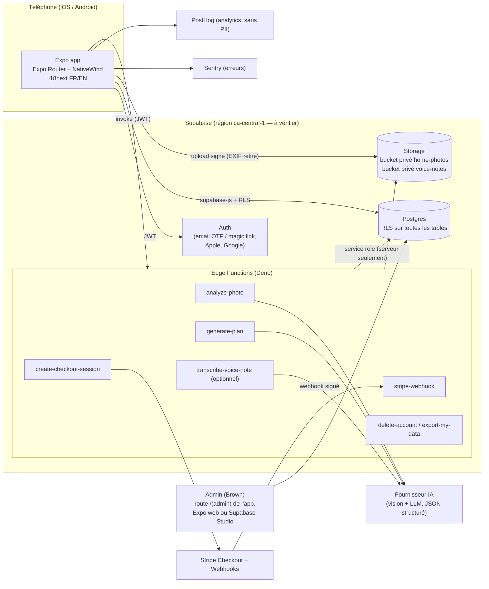
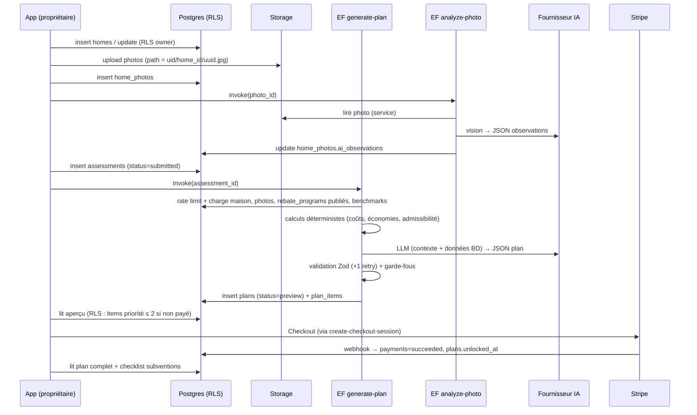

# 01 — Architecture

Responsable : **Tech Lead / Architecte** (voir `07-team-roles.md`).

## 1. Principes
- **Client léger, serveur de confiance** : l'app Expo n'affiche et ne collecte que ; toute logique sensible (IA, paiement, admissibilité, déverrouillage du plan) s'exécute dans Postgres (RLS, fonctions) ou dans des **Supabase Edge Functions**.
- **Déterministe d'abord, IA ensuite** : les calculs d'économies, les fourchettes de coûts et l'admissibilité aux subventions sont calculés par du code testé à partir de tables BD ; le LLM priorise, explique et rédige (voir `06-ai-pipeline.md`).
- **Données de référence éditables** : `rebate_programs`, `rebate_rules`, `measure_benchmarks` sont modifiables par l'admin, avec `source_url` + `last_verified_at`.
- **Un seul langage** : TypeScript partout (Expo, Edge Functions Deno, schémas partagés).
- **Coût minimal** : services managés à palier gratuit au départ ; pas de serveur à maintenir.

## 2. Diagramme de haut niveau



## 3. Flux principal : génération de plan



## 4. Structure du monorepo (cible)

Gestionnaire : **pnpm workspaces** (Turborepo optionnel plus tard si les builds ralentissent). Vérifié le 2026-10-19 sur la doc Expo (SDK 58, [monorepos](https://docs.expo.dev/guides/monorepos) et [create-expo-app](https://docs.expo.dev/more/create-expo/)) : Metro détecte les workspaces tout seul depuis le SDK 52 ; les installs isolées pnpm sont supportées depuis le SDK 54, mais certaines bibliothèques React Native ne s'y résolvent pas. `create-expo-app` avec pnpm écrit `nodeLinker: hoisted`. **Décision M0-01 :** `nodeLinker: hoisted` dans `pnpm-workspace.yaml`. On ne passe à l'isolation que si une dépendance l'exige. Le template `default@sdk-58` (M0-02) place les routes Expo Router dans `src/app/`, pas dans `app/` à la racine du paquet. TypeScript du monorepo : `~6.0.3`, la version du template SDK 58.

```
renoroute/
├── apps/
│   ├── mobile/                      # Expo app (iOS/Android ; web pour /(admin) seulement en MVP)
│   │   ├── src/
│   │   │   ├── app/                 # Expo Router. SDK 58 place les routes ici (pas à la racine de l'app)
│   │   │   │   ├── _layout.tsx      # providers: i18n, auth, query, theme, Sentry
│   │   │   │   ├── (auth)/          # welcome, sign-in, verify, consent
│   │   │   │   ├── (onboarding)/    # language, profile, postal code
│   │   │   │   ├── (app)/           # tabs: home, plan, rebates, account
│   │   │   │   │   ├── home/        # intake wizard steps
│   │   │   │   │   ├── photos/
│   │   │   │   │   ├── plan/[planId].tsx
│   │   │   │   │   ├── rebates/
│   │   │   │   │   └── account/
│   │   │   │   └── (admin)/         # rebate table CRUD (role=admin)
│   │   │   ├── components/          # UI primitives (Button, Card, Field…)
│   │   │   ├── features/            # auth, intake, photos, plan, payments, rebates, admin
│   │   │   ├── lib/                 # supabase client, i18n init, analytics, sentry
│   │   │   └── theme/               # tokens → NativeWind config
│   │   ├── app.config.ts            # imports BRAND from @renoroute/shared
│   │   ├── eas.json
│   │   └── .maestro/                # E2E flows
│   └── web/                         # V2 : Next.js ou Expo web (décision V2)
├── supabase/
│   ├── config.toml
│   ├── migrations/                  # 0001_init.sql, 0002_…
│   ├── seed.sql                     # données de dev (subventions non publiées)
│   ├── tests/                       # pgTAP (RLS)
│   └── functions/
│       ├── _shared/                 # cors, auth, rate-limit, ai-client, logger, zod (import shared)
│       ├── analyze-photo/
│       ├── generate-plan/
│       ├── create-checkout-session/
│       ├── stripe-webhook/
│       ├── delete-account/
│       ├── export-my-data/
│       └── transcribe-voice-note/   # optionnel MVP
├── packages/
│   └── shared/
│       └── src/
│           ├── config/brand.ts      # SEUL endroit du nom de l'app
│           ├── schemas/             # Zod : home, photo, assessment, plan, rebate…
│           ├── types/               # types générés Supabase (database.types.ts)
│           ├── calc/                # calculs déterministes (économies, admissibilité)
│           ├── i18n/
│           │   ├── fr.json
│           │   ├── en.json
│           │   └── index.ts         # resolveLocale + Intl (sans React ; init i18next dans apps/mobile)
│           └── constants/           # enums partagés (miroir des enums SQL)
├── docs/                            # ce pack
├── .github/workflows/               # ci.yml, eas-build.yml, security.yml
├── AGENTS.md  CLAUDE.md  README.md
├── .env.example  .gitignore
└── package.json  pnpm-workspace.yaml  tsconfig.base.json
```

Partage de code avec Deno : les Edge Functions importent `packages/shared` via chemin relatif ou `import_map`/`deno.json` (**à vérifier** selon la version CLI Supabase). Règle : `packages/shared` ne dépend d'aucun module React Native ni Node-only, uniquement de `zod` et de code pur TS.

## 5. Exemple minimal de config (squelette, pas d'implémentation)

`pnpm-workspace.yaml`
```yaml
packages:
  - "apps/*"
  - "packages/*"

nodeLinker: hoisted
```

`apps/mobile/app.config.ts`
```ts
import type { ExpoConfig } from 'expo/config';
import { BRAND } from '@renoroute/shared/config/brand';

const config: ExpoConfig = {
  name: BRAND.name,
  slug: BRAND.slug,
  scheme: BRAND.scheme,
  ios: { bundleIdentifier: BRAND.iosBundleId, supportsTablet: false },
  android: { package: BRAND.androidPackage },
  plugins: ['expo-router', 'expo-localization', '@sentry/react-native/expo'], // plugin ajouté seulement si SENTRY_ORG et SENTRY_PROJECT sont définis
  extra: { eas: { projectId: process.env.EAS_PROJECT_ID } },
};
export default config;
```

`tsconfig.base.json` (extrait)
```json
{ "compilerOptions": { "strict": true, "noUncheckedIndexedAccess": true, "noImplicitOverride": true, "exactOptionalPropertyTypes": false, "moduleResolution": "bundler", "allowImportingTsExtensions": true, "noEmit": true } }
```

## 6. Environnements
| Env | Supabase | Stripe | EAS channel | Usage |
|---|---|---|---|---|
| `local` | `supabase start` (Docker) | test mode | dev client | dev |
| `staging` | pas encore créé (voir ci-dessous) | test mode | `preview` | bêta interne / TestFlight |
| `prod` | `renoroute-prod`, ref `ujqqgsxpnwrqyqsosdnt`, région `ca-central-1` | live | `production` | stores |

**Région (décision Brown, 2026-10-20).** La région la plus proche du Canada et du nord-est des États-Unis, et la seule région canadienne proposée par l'API de création, est `ca-central-1` (Canada Central). Elle est disponible : le projet prod y a été créé le 2026-10-20. Organisation : `VernoB's Org` (`ytyypzhivxpveteqzail`), palier gratuit, coût annoncé `0` $/mois. Postgres `17`, comme le stack local.

**Staging.** La création de `renoroute-staging` a été refusée par l'API : le propriétaire a atteint la limite de **2 projets gratuits actifs** (message du 2026-10-20). Les deux projets actifs sont `omnidropai` et `renoroute-prod`. **Décision Brown (2026-10-20) : prod seule jusqu'à M6** (ADR-008). Le staging reste non créé. Aucun autre projet n'est mis en pause ni supprimé. Le local Docker tient lieu d'environnement de développement jusqu'à M6, ou plus tôt si une place gratuite ou un palier payant existe.

**Clés.** Aucune clé (publishable, anon, service role, Sentry, PostHog) n'est dans le dépôt. Elles restent dans le tableau de bord Supabase, Sentry et PostHog. Les secrets GitHub Actions et EAS seront remplis quand ces outils existeront (M0-07, M0-10).

**Observabilité (M0-09, code en place, tableaux de bord pas encore créés).** L'app initialise Sentry seulement si `EXPO_PUBLIC_SENTRY_DSN` est défini, avec `sendDefaultPii: false`, replay à 0, et un `beforeSend` qui ne garde que `user.id`. Les Edge Functions font de même avec le secret `SENTRY_DSN` (`npm:@sentry/deno@11.8.0`). PostHog ne démarre que si `EXPO_PUBLIC_POSTHOG_KEY` est défini. L'événement de lancement est `app_opened` avec la seule propriété `app_env`. L'autocapture tactile est coupée. L'autocapture d'écran est rejetée sur les segments `account`, `auth`, `consent`, `intake`, `photos` et `verify`. Un événement qui porte `email` ou d'autres champs personnels est rejeté. Hébergement PostHog : `https://us.i.posthog.com` par défaut — **à vérifier** (US ou EU ; pas de région canadienne connue).

**EAS (M0-10, projet lié, builds pas lancés).** Projet Expo `f37f3a15-00e6-44a8-9cdd-ae7fe87abd93`, écrit dans `apps/mobile/app.config.ts` (`extra.eas.projectId`). Ce n'est pas un secret. `apps/mobile/eas.json` définit `development`, `preview` et `production`, chacun avec `environment` du même nom. Les variables à poser dans EAS, pas dans le dépôt : `EXPO_PUBLIC_APP_ENV`, `EXPO_PUBLIC_SUPABASE_URL`, `EXPO_PUBLIC_SUPABASE_ANON_KEY`, `EXPO_PUBLIC_SENTRY_DSN`, `EXPO_PUBLIC_POSTHOG_KEY`, `EXPO_PUBLIC_POSTHOG_HOST`, `EXPO_PUBLIC_DEFAULT_LOCALE`, plus `SENTRY_AUTH_TOKEN`, `SENTRY_ORG` et `SENTRY_PROJECT` pour les source maps. Le build preview iOS exige un compte Apple Developer. Le build preview Android (APK interne) exige un compte Expo. Aucun build n'est lancé tant que ces comptes ne sont pas connectés.

**MFA.** Brown a confirmé le 2026-10-20 que le TOTP du compte Supabase est activé (enrôlement dans [Account → Security](https://supabase.com/dashboard/account/security) ; non vérifiable par l'API). L'obligation MFA pour toute l'organisation exige un palier Pro, Team ou Enterprise.

Coût : le palier gratuit de cette organisation limite à 2 projets actifs (vérifié le 2026-10-20) et peut mettre en pause un projet inactif. Prod sur palier Pro au lancement si on veut éviter cette pause (**à vérifier** le délai exact au moment du lancement).

## 7. Décisions d'architecture (ADR courtes)
- **ADR-001** Supabase plutôt que Firebase : Postgres relationnel (règles de subventions, jointures), RLS SQL testable, région canadienne possible, open source (sortie possible).
- **ADR-002** Expo plutôt que natif ou Flutter : un seul code TS iOS/Android/web, EAS pour build sans Mac obligatoire, OTA updates.
- **ADR-003** Calcul déterministe + LLM pour la narration : réduit les hallucinations sur chiffres et subventions, rend les résultats testables.
- **ADR-004** Admin MVP dans l'app (route `(admin)` via Expo web) plutôt qu'un back-office séparé ; fallback Supabase Studio. **Décision Brown.**
- **ADR-005** Stripe Checkout hébergé (navigateur) plutôt que formulaire carte natif : PCI minimal. Risque IAP à valider (voir `05-security.md` §11).
- **ADR-006** Abstraction fournisseur IA (`supabase/functions/_shared/ai-client.ts`) pour changer de modèle sans toucher la logique.
- **ADR-007** NativeWind v4.2.7 épinglé, plutôt que Tamagui. **Décision Brown (2026-10-19).** Contexte : M0-03. Au 2026-10-19, `nativewind@latest` est 4.2.7 ; la v5 (`5.0.0-rc.0`) est encore une release candidate. Conséquences : tokens dans `apps/mobile/src/theme/tokens.ts` injectés dans `tailwind.config.ts` ; ne pas passer en v5 sans une nouvelle ADR. Tamagui reste une option de V2 si le partage web/native le justifie.
- **ADR-008** Production seule jusqu'à M6. **Décision Brown (2026-10-20).** Contexte : M0-06. L'API a refusé `renoroute-staging` parce que le palier gratuit limite l'organisation à 2 projets actifs. Conséquences : pas de Supabase staging avant M6 ; le développement reste sur `supabase start` ; le ref de prod est écrit seulement au §6 ; M0-06 reste ouverte. À revoir à M6 (place gratuite ou palier payant).

Toute nouvelle ADR s'ajoute ici (numéro suivant, contexte, décision, conséquences).
