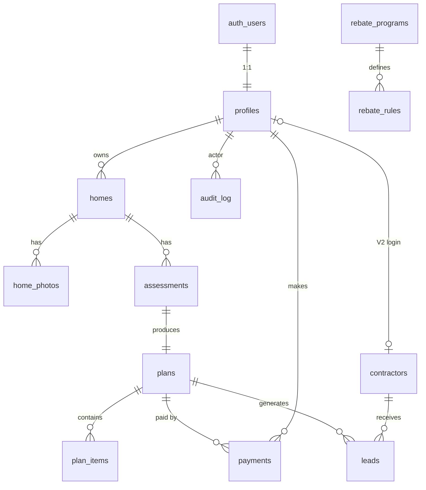

# 03 — Base de données (Supabase Postgres)

Responsable : **Backend/DB dev**. Revue obligatoire : **Security engineer** pour toute policy RLS.
Migration de référence : `supabase/migrations/0001_init.sql` (ce document la décrit ; en cas d'écart, **la migration fait foi** et ce doc doit être corrigé dans la même PR).

## 1. Principes
- **RLS activé sur toutes les tables.** Les privilèges partent de zéro (`revoke all`) puis on accorde le minimum, **par colonne** quand le client peut écrire (ex. `profiles.role` n'est jamais modifiable par le client).
- **Écritures privilégiées** (plans, paiements, journaux, leads) uniquement par Edge Functions avec la clé `service_role` (côté serveur).
- **Minimisation (PIPEDA)** : pas d'adresse civique, seulement la **RTA** (3 premiers caractères du code postal, ex. `E1C`) ; revenu en **tranche** optionnelle ; aucune photo dans la BD (seulement le chemin Storage).
- **Données de référence éditables** (`rebate_programs`, `rebate_rules`, `measure_benchmarks`) : chaque ligne a `source_url` (https obligatoire) et `last_verified_at` (non nul). Seules les lignes `is_published` / `is_active` sont visibles du public et utilisées par l'IA. Chaque modification est journalisée dans `audit_log` (trigger).
- Clés `uuid` (`gen_random_uuid()`), dates `timestamptz`, montants `numeric` en CAD (paiements en **cents** `int`).
- Types TS générés : `supabase gen types typescript` → `packages/shared/src/types/database.types.ts` (tâche CI : échoue si non à jour).

## 2. Diagramme ER


`plan_items.matched_rebates` (jsonb) référence `rebate_programs.id` / `rebate_rules.id` ; `plans.rebate_snapshot` fige les données de programmes utilisées (traçabilité si un programme change après coup).

## 3. Enums
| Enum | Valeurs |
|---|---|
| `user_role` | homeowner, contractor, admin |
| `app_locale` | fr, en |
| `home_type` | detached, semi_detached, row_house, mobile_home, cottage, duplex, other |
| `heating_system` | electric_baseboard, electric_furnace, oil_furnace, oil_boiler, propane, natural_gas, wood_stove, pellet_stove, mini_split_heat_pump, central_heat_pump, geothermal, other, unknown |
| `electric_utility` | nb_power, saint_john_energy, energie_edmundston, perth_andover, other, unknown |
| `income_band` | under_70k, from_70k_to_100k, from_100k_to_150k, over_150k, prefer_not_to_say |
| `photo_category` | exterior, window, door, attic, basement, heating_equipment, water_heater, electrical_panel, energy_bill, room, other |
| `assessment_status` | draft, submitted, processing, completed, failed |
| `plan_status` | preview, unlocked, archived |
| `measure_code` | pre_evaluation, air_sealing, attic_insulation, wall_insulation, basement_insulation, windows, doors, mini_split_heat_pump, central_heat_pump, heat_pump_water_heater, smart_thermostat, ventilation_hrv, solar_pv, other |
| `item_status` | todo, in_progress, done, skipped |
| `program_status` | open, waitlist, full, announced, paused, closed |
| `amount_type` | fixed, per_unit, range, percent, loan, financing, rental, fee |
| `contractor_status` | pending, vetted, suspended |
| `lead_status` | requested, sent, accepted, declined, won, lost, cancelled |
| `payment_status` | pending, succeeded, failed, refunded |

Les enums sont dupliqués dans `packages/shared/src/constants/` (tableaux `as const` + `z.enum`) ; un test vérifie qu'ils correspondent aux types générés.

Note : la frontière « 70 k$ » de `income_band` correspond au critère connu du programme Enhanced Energy Savings (≤ 70 000 $). Le revenu médian utilisé par la future remise fédérale n'est pas encore connu → la tranche pourra devoir être affinée (migration ultérieure) — **à vérifier** quand les règles seront publiées.

## 4. Tables

### 4.1 `profiles`
| Colonne | Type | Notes |
|---|---|---|
| id | uuid PK → auth.users.id | cascade à la suppression du compte |
| role | user_role | défaut homeowner ; **non modifiable par le client** |
| full_name | text ≤120 | optionnel |
| preferred_locale | app_locale | défaut fr |
| phone | text ≤30 | optionnel (V2 leads) |
| postal_code_fsa | text `^[A-Z]\d[A-Z]$` | RTA seulement |
| consent_terms_version / consent_terms_at | text / timestamptz | version des CGU acceptées |
| consent_ai_at | timestamptz | consentement explicite au traitement IA (incl. hors Canada) |
| consent_marketing | bool | défaut false (LCAP / CASL) |
| created_at / updated_at | timestamptz | trigger |

Création automatique par trigger `on_auth_user_created`. **RLS** : select propre ligne (ou admin) ; update propre ligne sur colonnes autorisées seulement. Pas d'insert/delete client.

### 4.2 `homes`
Colonnes : id, owner_id → profiles, label, province (NB par défaut ; QC/NS/PE/NL pour V3), postal_code_fsa, municipality, year_built (1700–2100), home_type, storeys, floor_area_sqft (100–20 000), has_basement, heating_primary, heating_secondary, water_heater, electric_utility, annual_electricity_kwh, annual_energy_cost_cad, annual_oil_litres, occupants, household_income_band (sensible, optionnel), owner_occupied, notes (≤2000, **texte non fiable** pour l'IA), energy_advisor_status (`none` par défaut, puis `contacted`, `pre_evaluation_booked`, `pre_evaluation_done`, `post_evaluation_done`), pre_evaluation_date, created_at, updated_at. Pas de réservation de conseiller dans l'app. Le lien officiel et les règles Énergie NB sont `TODO(verify)`.
**RLS** : CRUD complet pour le propriétaire (`owner_id = auth.uid()`) ; admin en lecture (support).

### 4.3 `home_photos`
Colonnes : id, home_id → homes, owner_id → profiles, category, storage_path (unique, `{owner_id}/{home_id}/{uuid}.jpg`, contrainte vérifiant le préfixe), width, height, bytes (≤5 Mo), exif_stripped (mis à true par le serveur après vérification), ai_observations (jsonb validé Zod), ai_analyzed_at, created_at.
**RLS** : propriétaire select/insert/delete ; insert exige que la maison lui appartienne ; update limité à `category`. `ai_observations`/`exif_stripped` écrits par `analyze-photo` (service role).

### 4.4 `assessments`
Une demande de génération. Colonnes : id, home_id, owner_id, status, locale, input_snapshot (jsonb figé côté serveur), voice_note_path, transcript, model_info (fournisseur, modèle, `prompt_version`), ai_cost_usd, error_code, created_at, submitted_at, completed_at.
**RLS** : propriétaire select ; insert seulement en `draft` et pour sa maison ; update (voice_note_path, locale) seulement tant que `draft`. Les transitions `submitted → processing → completed/failed` sont faites par `generate-plan`.

### 4.5 `plans`
Colonnes : id, assessment_id (unique), home_id, owner_id, status, locale, summary_fr/en, total_cost_low/high_cad, annual_savings_low/high_cad, rebates_low/high_cad, content (jsonb `PlanOutput`), schema_version, rebate_snapshot (jsonb), disclaimer_version, product_code, unlocked_at, created_at.
**RLS** : lecture propriétaire/admin ; **aucune écriture client**. `unlocked_at` est posé uniquement par `stripe-webhook`.
⚠️ Tant que `unlocked_at` est nul, `content` ne contient que le résumé et les 2 premiers items (pas de fuite du plan payant via ce champ). Le contenu complet est écrit à l'unlock.

### 4.6 `plan_items`
Colonnes : id, plan_id, owner_id, priority (1–50, unique par plan), measure, title_fr/en, rationale_fr/en, cost_low/high_cad, savings_low/high_cad, savings_kwh_low/high, matched_rebates (jsonb `[{program_id, rule_id, amount_min, amount_max, status}]`), confidence (low/medium/high), status (checklist), status_updated_at, created_at.
**RLS** : lecture propriétaire si `priority <= 2` **ou** plan déverrouillé ; update `status`/`status_updated_at` seulement si plan déverrouillé.

### 4.7 `rebate_programs` (éditable admin)
Colonnes : id, slug (unique), jurisdiction (`NB`, `CA` fédéral, `NB-SJ`…), administrator, name_fr/en, summary_fr/en, status, requires_pre_evaluation, pre_evaluation_fee_cad, pre_evaluation_fee_note, completion_window_months, income_max_cad, waitlist_note_fr/en, applies_to_utilities (null = toutes), official_url, **source_url (https, requis)**, **last_verified_at (requis)**, verified_by, opens_on, closes_on, is_published (défaut **false**), internal_notes, created_at, updated_at.
**RLS** : lecture publique si `is_published` (admin voit tout) ; écriture admin. Trigger d'audit.

### 4.8 `rebate_rules` (éditable admin)
Colonnes : id, program_id, measure, amount_type, amount_min_cad, amount_max_cad, unit_label_fr/en, max_units, conditions (jsonb validé par Zod `RebateConditions`), eligibility_notes_fr/en, source_url, last_verified_at, is_active, created_at, updated_at.
Exemple `conditions` : `{"requires_program_pre_evaluation": true, "max_household_income_cad": 70000, "eligible_heating_before": ["electric_baseboard","oil_furnace"], "utilities": ["nb_power"]}`.
**RLS** : lecture si actif et programme publié ; écriture admin. Trigger d'audit.

### 4.9 `measure_benchmarks` (éditable admin — ajout au schéma demandé)
Fourchettes de coûts et d'économies par mesure, pour que **l'IA n'invente pas les chiffres**. Colonnes : id, province, measure, cost_low_cad, cost_high_cad, cost_unit, savings_pct_low/high, assumptions (jsonb), source_url, last_verified_at, is_active, updated_at. Unique (province, measure, cost_unit).
**RLS** : lecture publique si actif ; écriture admin. Le seed (`0006_measure_benchmarks_seed.sql`, source unique `docs/research/benchmarks/measure_benchmarks.csv`) insère les fourchettes avec `is_active=false` jusqu'à vérification Brown. Extra CSV (`name_*`, extrait, notes) dans `assumptions`. La table n'a pas `is_published`.

### 4.10 `contractors` (table MVP, fonctionnalités V2)
Colonnes : id, profile_id (unique, V2 login), business_name, contact_email, contact_phone, website_url, service_fsas (text[]), measures (measure_code[]), languages, insurance_verified_at, licence_notes, status, subscription_status, stripe_customer_id, created_at, updated_at.
**RLS** : admin tout ; entrepreneur lit sa ligne. Les propriétaires ne listent pas les entrepreneurs directement (exposition via fonction de matching V2 qui ne renvoie que les entrepreneurs `vetted`).

### 4.11 `leads` (V2)
Colonnes : id, plan_id, homeowner_id, contractor_id, plan_item_ids, status, **consent_share_at (requis)**, shared_payload (données minimales réellement partagées), referral_fee_cad, created_at, updated_at.
**RLS** : propriétaire lit les siens ; entrepreneur `vetted` lit ceux qui lui sont assignés ; écriture par Edge Function `create-lead` (V2).

### 4.12 `payments`
Colonnes : id, owner_id (null après suppression du compte), plan_id, product_code (`renoroute_plan_standard` / `renoroute_plan_premium` ; montants dans `packages/shared/src/payments/products.ts`), amount_cents, tax_cents, currency (`cad`), status, **provider** (`stripe` | `revenuecat`, `0007_payments_provider.sql`), provider_event_id (idempotence), revenuecat_event_id (unique), stripe_checkout_session_id (unique), stripe_payment_intent_id (unique), stripe_event_last_id (idempotence Stripe), created_at, updated_at.
**RLS** : lecture propriétaire/admin ; écriture uniquement `stripe-webhook` / `revenuecat-webhook` / `create-checkout-session`. Conservation pour fins fiscales (durée **à vérifier** avec comptable ; l'ARC exige généralement 6 ans). `plans.unlocked_at` reste l'entitlement (ADR-011).

### 4.13 `audit_log`
Colonnes : id (identity), actor_id, action, entity, entity_id, metadata (jsonb **sans PII**), created_at.
Insertion par service role ou triggers SECURITY DEFINER ; lecture admin seulement. Sert aussi au **rate limiting** via `recent_action_count(actor, action, window)` (exécutable par service role uniquement).

### 4.14 `waitlist` (landing page de validation — `0002_waitlist.sql`)
Colonnes : id, email (unique insensible à la casse), town, heat (baseboard/oil/heatpump/wood/other), intent (reserve/waitlist), locale, price_variant (49/99), utm_source/campaign/content, consent_marketing (doit être vrai), consent_text_version, created_at, unsubscribed_at, converted_profile_id.
**RLS** : `anon`/`authenticated` peuvent **seulement insérer** (colonnes limitées, consentement requis) ; lecture/modification/suppression admin seulement. Un doublon de courriel renvoie 409 (traité comme succès par la landing, sans révéler l'existence de l'inscription).

### 4.15 `energy_prices` (éditable admin — `0003_energy_prices.sql`)
Prix de l'énergie utilisés par `packages/shared/src/calc/`. Colonnes : id, fuel (`electricity`, `heating_oil`, `propane`, `wood_pellets`, `natural_gas`), unit, price_cad, effective_from, source_url, verified_at, is_published. Le seed insère une ligne par combustible avec `is_published=false`, `price_cad` NULL, `source_url` NULL et `unit` = `TODO(verify)`. Ce ne sont pas des tarifs du Nouveau-Brunswick.
**RLS** : un utilisateur authentifié lit seulement les lignes publiées ; l'admin écrit ; `anon` n'a aucun droit ; `service_role` contourne la RLS. L'écran d'édition est noté sur M5-02.

### 4.16 `rebate_checklist_items` (éditable admin — `0005_rebate_checklist.sql`)
Modèle de dossier par programme : documents, factures, numéros de modèle, échéances, rappels. Colonnes : id, program_id, kind, label_fr, label_en, sort_order, source_url, is_published. Aucune ligne n'est semée : les libellés viennent de Brown, avec une source, pas du code. RénoRoute ne dépose pas les demandes au MVP. L'export PDF du plan, pour l'entrepreneur et le conseiller, est la tâche M5-07.
**RLS** : lecture authentifiée si la ligne et le programme sont publiés ; écriture admin ; `anon` sans droit.

## 5. Storage
| Bucket | Public | Limite | Types | Chemin |
|---|---|---|---|---|
| `home-photos` | non | 5 Mo | jpeg/png/webp | `{uid}/{home_id}/{uuid}.jpg` |
| `voice-notes` | non | 10 Mo | audio (liste à vérifier) | `{uid}/{assessment_id}/{uuid}.m4a` |

Policies : select/insert/delete si le 1er dossier du chemin = `auth.uid()`. Pas d'update (objets immuables). Affichage via **URL signées courtes** (ex. 60–300 s).

## 6. Matrice RLS (résumé)
| Table | anon | homeowner (propre) | contractor (V2) | admin | service_role |
|---|---|---|---|---|---|
| profiles | — | R, U(colonnes) | R propre | R | tout |
| homes | — | CRUD | — | R | tout |
| home_photos | — | R, C, D, U(category) | — | — | tout |
| assessments | — | R, C(draft), U(draft) | — | — | tout |
| plans | — | R | — | R | tout |
| plan_items | — | R (top 2 ou payé), U(status si payé) | — | R | tout |
| rebate_programs / rules / measure_benchmarks | R publiés | R publiés | R publiés | CRUD | tout |
| energy_prices | — | R publiés | — | CRUD | tout |
| rebate_checklist_items | — | R publiés (programme publié) | — | CRUD | tout |
| contractors | — | — | R propre | CRUD | tout |
| leads | — | R propres | R assignés | R | tout |
| payments | — | R | — | R | tout |
| audit_log | — | — | — | R | tout |

## 7. Tests RLS (pgTAP, `supabase/tests/`)
Obligatoires avant M6 — fichier `0008_rls_seven_scenarios.sql` (M6-03) :
1. Utilisateur A ne voit aucune ligne de B (homes, photos, assessments, plans, plan_items, payments, leads).
2. Client ne peut pas modifier `profiles.role` (erreur de privilège).
3. Plan non payé : seulement 2 `plan_items` visibles ; après `unlocked_at` : tous.
4. Client ne peut pas insérer dans `plans`, `payments`, `audit_log`.
5. anon ne voit pas les programmes `is_published = false`.
6. Non-admin ne peut pas écrire `rebate_programs`.
7. Storage : upload refusé hors de son dossier `{uid}/`.

Revue Security Advisor (projet `renoroute-prod`, 2026-10-23) : aucun avis.

## 8. Seed (`supabase/seed.sql`, à créer en M5)
Contient les programmes connus **avec `is_published = false`** tant que Brown n'a pas vérifié chaque ligne sur la source officielle. Données de départ (fournies par Brown, **à re-vérifier** — les programmes changent souvent) :

| slug | statut | Points clés (à vérifier) |
|---|---|---|
| `nbp-total-home-energy-savings` | open | Évaluation énergétique 99 $ + TVH **avant** tout achat ; 9 mois pour compléter ; 400 $/thermopompe mini-split ; 1 500 $ thermopompe centrale ; 50 $ par fenêtre/porte ; 250–550 $ étanchéisation à l'air |
| `nbp-enhanced-energy-savings` | full / waitlist | Ménages ≤ 70 000 $ ; complet, liste d'attente jusqu'à ~2 ans |
| `ca-greener-homes-loan` | closed | Fermé le 1er oct. 2025 (garder pour historique, non publié) |
| `ca-national-heat-pump-rebate` | announced | Annoncé le 8 oct. 2026 ; lancement début 2027 ; jusqu'à 10 000 $ sous le revenu médian / 2 000 $ autres ; règles détaillées non publiées |
| `sje-heat-pump-rental-financing` | open (à vérifier) | Saint John Energy : location de thermopompes et financement jusqu'à 10 000 $ ; clients SJE seulement |

`source_url` : URL exacte de la page officielle de chaque programme — **à trouver et coller par Brown** (pas de lien deviné). `last_verified_at` = date de la vérification réelle.

Exemple de squelette (valeurs à confirmer) :
```sql
insert into public.rebate_programs (slug, jurisdiction, administrator, name_fr, name_en, status,
  requires_pre_evaluation, pre_evaluation_fee_cad, pre_evaluation_fee_note, completion_window_months,
  source_url, last_verified_at, is_published)
values ('nbp-total-home-energy-savings', 'NB', 'NB Power',
  'Programme d''économies d''énergie pour toute la maison', 'Total Home Energy Savings Program', 'open',
  true, 99.00, '+HST', 9,
  'https://TODO-verify-official-url', '2026-10-19', false);  -- source_url check requires https://; replace before publishing
```
(Les noms français officiels des programmes sont **à vérifier** sur le site d'Énergie NB.)

## 9. Évolutions prévues
- V2 : fonction `match_contractors(plan_id)` SECURITY DEFINER ; table `contractor_subscriptions` si nécessaire.
- V3 : `province`/`jurisdiction` déjà présents ; ajouter utilities QC/NS (Hydro-Québec, Nova Scotia Power…) par migration d'enum.
- Suppression de compte : Edge Function `delete-account` supprime fichiers Storage puis `auth.admin.deleteUser` (cascade) ; `payments.owner_id` → null.
