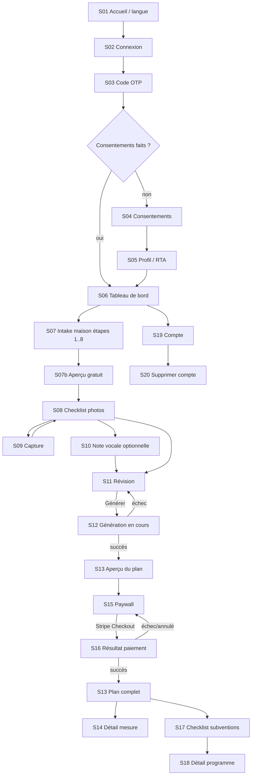

# 04 — UI / UX

Responsable : **UI/UX designer**. Implémentation : **Mobile dev**.

## 1. Principes de design
1. **Mobile-first, une main** : actions principales en bas d'écran, cibles ≥ 44×44 pt (iOS) / 48×48 dp (Android).
2. **Une question par écran** dans l'intake (wizard), barre de progression, sauvegarde automatique à chaque étape (on peut quitter et revenir).
3. **Clarté avant tout** : langage simple (niveau ~8e année), pas de jargon énergétique sans explication (« thermopompe (heat pump) », « étanchéisation (air sealing) »).
4. **Fourchettes, pas de fausse précision** : toujours « 1 200 $ – 2 500 $ », jamais un chiffre unique ; badge de confiance (faible/moyenne/élevée).
5. **Confiance et transparence** : chaque subvention affiche sa source et « vérifié le … » ; l'avis légal est visible, pas caché.
6. **Ordre d'action explicite** : mettre en évidence l'étape bloquante (« Réservez l'évaluation NB Power **avant** d'acheter quoi que ce soit »).
7. **Bilingue natif** : bascule FR/EN dans Compte et à l'accueil ; mises en page qui supportent +30 % de texte.
8. **Accessible** : WCAG 2.2 AA, tailles de police dynamiques, lecteurs d'écran (VoiceOver/TalkBack).
9. **Tolérant aux connexions lentes** (zones rurales NB) : compression photo, envois en file avec reprise, états hors-ligne clairs.

## 2. Liste des écrans (MVP)
| ID | Route (Expo Router) | Écran |
|---|---|---|
| S01 | `(auth)/welcome` | Accueil + choix langue |
| S02 | `(auth)/sign-in` | Courriel (OTP/magic link) + Apple/Google |
| S03 | `(auth)/verify` | Saisie code OTP |
| S04 | `(auth)/consent` | CGU, politique de confidentialité, consentement IA (séparés) |
| S05 | `(onboarding)/profile` | Prénom (optionnel), RTA (code postal 3 car.) |
| S06 | `(app)/home/index` | Tableau de bord (maison, statut du plan, prochaine action) |
| S07 | `(app)/home/intake/[step]` | Wizard maison (≈8 étapes) |
| S07b | `(app)/home/preview` | Aperçu gratuit (fourchettes + 2–3 mesures) |
| S08 | `(app)/photos/index` | Checklist photos par catégorie |
| S09 | `(app)/photos/capture` | Caméra avec conseils de cadrage |
| S10 | `(app)/home/voice-note` | Note vocale (optionnelle) |
| S11 | `(app)/home/review` | Résumé + « Générer mon plan » |
| S12 | `(app)/plan/generating` | Progression (étapes) |
| S13 | `(app)/plan/[planId]` | Aperçu (2 items) + paywall / plan complet |
| S14 | `(app)/plan/[planId]/item/[itemId]` | Détail d'une mesure |
| S15 | `(app)/plan/[planId]/paywall` | Choix d'offre + paiement Stripe |
| S16 | `(app)/plan/payment-result` | Retour Stripe (deep link) succès/échec |
| S17 | `(app)/rebates/index` | Checklist subventions (étapes, échéances) |
| S18 | `(app)/rebates/[programId]` | Détail programme (source, vérifié le) |
| S19 | `(app)/account/index` | Langue, données, export, suppression, déconnexion |
| S20 | `(app)/account/delete` | Suppression de compte (confirmation) |
| A01 | `(admin)/rebates` | Liste des programmes (filtre statut, « à revérifier ») |
| A02 | `(admin)/rebates/[id]` | Édition programme + règles |
| A03 | `(admin)/benchmarks` | Édition des coûts de référence |

## 3. Flux utilisateur

## 4. Wireframes (descriptions)

**S01 Accueil** — Logo/nom (depuis `BRAND`), titre « Votre plan de rénovation, étape par étape », 3 puces de valeur (plan priorisé, subventions NB, coûts estimés), boutons « Français » / « English » (segmenté), CTA principal « Commencer », lien « J'ai déjà un compte ». Pied : avis court « Non affilié à Énergie NB ».

**S02 Connexion** — Champ courriel, CTA « Recevoir un code », boutons « Continuer avec Apple » (iOS obligatoire si autre connexion sociale offerte — Apple guideline 4.8, à vérifier) et « Continuer avec Google ». Texte d'aide.

**S03 Code** — 6 cases OTP (auto-fill iOS/Android), renvoyer le code (minuterie 60 s), message d'erreur clair.

**S04 Consentements** — 3 blocs distincts avec cases **non pré-cochées** : (1) CGU + politique (liens) — requis ; (2) traitement IA de mes données et photos, possiblement hors Canada, par [fournisseur] — requis pour générer un plan, explication en 2 lignes ; (3) courriels marketing — optionnel. CTA « Continuer ».

**S05 Profil** — Prénom (optionnel), RTA (« E1C » ; pourquoi on demande : programmes selon région/fournisseur d'électricité), fournisseur d'électricité (NB Power / Saint John Energy / Énergie Edmundston / Perth-Andover / je ne sais pas).

**S06 Tableau de bord** — Carte maison (étiquette, % complété), carte « Prochaine action » (ex. « Ajoutez 3 photos »), carte plan (statut : brouillon / génération / aperçu / complet), carte « Subventions : 1 étape urgente ». Tabs bas : Accueil · Plan · Subventions · Compte.

**S07 Wizard intake** (une question par écran, progression « 3/8 ») — 1 type de maison (cartes illustrées) · 2 année de construction (sélecteur par tranches + saisie exacte) · 3 superficie (pi² avec aide « ou nombre de chambres ») · 4 chauffage principal/secondaire (cartes avec icônes) · 5 chauffe-eau · 6 factures (kWh/an ou $/mois, litres d'huile ; option « je ne sais pas ») · 7 occupants + propriétaire occupant · 8 tranche de revenu **optionnelle** (explication : sert seulement à l'admissibilité, « préférer ne pas répondre »). Boutons « Retour » / « Suivant », « Passer » quand optionnel.

**S07b Aperçu gratuit** — Juste après l'intake, avant les photos. Fourchette de coûts et d'économies, plus 2 ou 3 mesures prioritaires. Les montants viennent du calcul et des données de référence, jamais d'un chiffre écrit dans l'écran. Pas de paiement : le paywall reste S15, après la génération du plan. Bandeau d'avis légal. L'utilisateur continue ensuite vers les photos. FR/EN.

**S08 Checklist photos** — Grille par catégorie (fenêtres, portes, entretoit, sous-sol, système de chauffage, chauffe-eau, panneau électrique, facture) avec état (0/2, ✓), recommandé vs optionnel, conseil « pas de visages ni d'adresses visibles ». Bouton « Ajouter depuis la galerie ».

**S09 Capture** — Caméra plein écran, cadre guide + astuce par catégorie (« Photographiez l'étiquette signalétique de la fournaise »), bouton déclencheur bas centre, aperçu + « Reprendre » / « Utiliser ». Indicateur d'envoi (file).

**S10 Note vocale** — Gros bouton micro, durée max (ex. 2 min), transcription affichée et modifiable, suppression possible.

**S11 Révision** — Résumé éditable par section, nombre de photos, avertissement si données manquantes (« plan moins précis »), CTA « Générer mon plan » (désactivé sans consentement IA).

**S12 Génération** — Étapes animées sobres (« Analyse des photos » → « Calcul des économies » → « Recherche des programmes » → « Rédaction du plan »), durée estimée, possibilité de quitter (notification/polling).

**S13 Plan** — En-tête : fourchettes totales (coût, économies annuelles, subventions potentielles). **Bandeau avis légal**. Liste ordonnée de cartes mesure (n°, titre, coût, économies, badges subventions, confiance). En aperçu : items 1–2 visibles, items 3+ floutés/verrouillés + CTA « Débloquer le plan complet ». Étape 1 souvent « Réserver l'évaluation énergétique » si programme exige pré-évaluation.

**S14 Détail mesure** — Pourquoi (rationale), fourchettes, subventions liées (lien S18), conseils pour soumissions entrepreneurs, statut checklist (À faire / En cours / Fait / Ignoré). V2 : « Trouver un entrepreneur ».

**S15 Paywall** — 1 ou 2 offres (selon test PostHog) : ce qui est inclus, prix CAD taxes en sus/incluses (**décision**), garantie/remboursement (**décision**), CTA « Payer de façon sécurisée » → Stripe Checkout (navigateur in-app).

**S16 Résultat paiement** — Succès : « Plan débloqué » (attend confirmation webhook, polling ≤ 30 s) ; échec : réessayer / support.

**S17 Checklist subventions** — Timeline ordonnée : « 1. Réserver l'évaluation (99 $ + TVH) avant achat », « 2. Travaux dans les 9 mois », … chaque élément avec statut programme (ouvert / liste d'attente / annoncé / fermé), échéances calculées, « vérifié le JJ/MM/AAAA », lien source. Avertissement : « Les programmes changent ; confirmez auprès de l'organisme. »

**S18 Détail programme** — Nom, administrateur, statut coloré + texte, montants par mesure (depuis `rebate_rules`), conditions en langage simple, bouton « Site officiel » (ouvre navigateur), date de vérification.

**S19 Compte** — Langue, notifications, consentements (modifier/retirer), « Télécharger mes données », « Supprimer mon compte », CGU/confidentialité, version, déconnexion.

**S20 Suppression** — Explication de ce qui est supprimé et de ce qui est conservé (reçus de paiement anonymisés pour fins fiscales), saisie « SUPPRIMER »/« DELETE », CTA destructif rouge.

**A01–A03 Admin** — Table dense (web) : nom, statut, `last_verified_at` (rouge si > 30 jours — seuil **décision Brown**), publié oui/non ; formulaire d'édition avec validation Zod (URL https obligatoire, dates) ; bouton « Marquer vérifié aujourd'hui ».

## 5. Design tokens
Définis une seule fois dans `apps/mobile/src/theme/tokens.ts` et injectés dans `tailwind.config.js` (NativeWind). Contrastes indicatifs à **re-valider** avec un vérificateur (ex. WebAIM Contrast Checker).

### Couleurs
| Token | Hex | Usage | Contraste visé |
|---|---|---|---|
| `primary-700` | `#1F6F50` | Boutons primaires, liens | ≈ 6:1 sur blanc (AA texte) |
| `primary-50` | `#E8F3EE` | Fonds de cartes actives | — |
| `accent-700` | `#B45309` | Mise en avant « urgent / avant achat » | ≈ 5:1 sur blanc |
| `neutral-900` | `#1A1F24` | Texte principal | > 15:1 |
| `neutral-600` | `#4B5563` | Texte secondaire | ≈ 7:1 |
| `neutral-200` | `#E5E7EB` | Bordures | non-texte ≥ 3:1 si fonctionnel → utiliser `neutral-400 #9CA3AF` pour bordures de champs |
| `surface` | `#FFFFFF` | Fond | — |
| `background` | `#F7F8F6` | Fond d'app | — |
| `success-700` | `#15803D` | Programme ouvert, étape faite | ≈ 5:1 |
| `warning-700` | `#A16207` | Liste d'attente | ≈ 4.9:1 (à vérifier) |
| `danger-700` | `#B42318` | Fermé, erreurs, suppression | ≈ 6:1 |
| `info-700` | `#1D4ED8` | Annoncé / à venir | ≈ 6:1 |
Mode sombre : V2 (prévoir les tokens sémantiques dès M0 pour ne pas refactorer).
Ne **jamais** transmettre un statut par la couleur seule : toujours icône + texte.

#### Extension v2 (19 oct. 2026 — landing v2, à appliquer aussi dans l'app)
| Token | Hex | Usage | Contraste |
|---|---|---|---|
| `primary-900` | `#0E3B2B` | Sections sombres, bouton actif de la bascule FR/EN, survol bouton primaire | blanc dessus ≈ 12:1 |
| `forest-950` | `#0A1F17` | Pied de page, bandeaux sombres | menthe dessus 12.7:1 |
| `primary-500` | `#2F9E73` | Décoratif seulement (illustrations, dégradés) — jamais du texte sur blanc | — |
| `mint-200` | `#BFE6D3` | Texte/accents sur fond sombre | 12.7:1 sur forest-950 |
| `sand-50` / `sand-100` | `#FBF8F1` / `#F3EDE0` | Fond chaud de page / sections | primary-700 dessus 5.7:1 |
| `accent-100` | `#FDEBD3` | Surface d'alerte douce (pastille « Risque » en `#92400E`, 6:1) | — |
| `accent-400` | `#F2A33A` | Décoratif (fenêtres allumées, chaleur) — jamais du texte | — |
### Typographie
Police texte : **Inter** (Google Fonts, licence OFL, accents français complets) via `@expo-google-fonts/inter`. **v2 :** police des titres **Bricolage Grotesque** (OFL) via `@expo-google-fonts/bricolage-grotesque` (paquet à vérifier à l'installation) pour `display`, `h1`, `h2`. Alternative lisibilité : **Atkinson Hyperlegible**.
| Token | Taille / interligne | Poids |
|---|---|---|
| `display` | 28 / 34 | 700 |
| `h1` | 24 / 30 | 700 |
| `h2` | 20 / 26 | 600 |
| `body` | 16 / 24 | 400 |
| `body-strong` | 16 / 24 | 600 |
| `caption` | 13 / 18 | 400 |
| `overline` (v2) | 12 / 16, majuscules, interlettrage 0.12em | 700 |
| `display-xl` (v2, web ≥ 960 px seulement) | 56 / 60 | 700 |
| `button` | 16 / 20 | 600 |
Respecter `allowFontScaling` (défaut) ; tester à 200 % ; ne pas fixer de hauteurs sur les conteneurs de texte.

### Espacement, rayons, ombres
Échelle 4 pt : `1=4, 2=8, 3=12, 4=16, 5=20, 6=24, 8=32, 10=40, 12=48` (+ v2 : `16=64, 24=96`, web). Marges d'écran : 16. Rayons : `sm=6, md=10, lg=16, xl=28 (v2 : grandes cartes, téléphone, formulaire), full=9999`. Ombres : elevation 1–2 sur cartes, elevation 3 (v2) pour les éléments héros. Mouvement (v2) : `fast=150ms, base=250ms, slow=600ms`, courbe `cubic-bezier(0.22,1,0.36,1)` (≈ `power3.out`) — Reanimated dans l'app, GSAP sur le web ; toujours désactivé si « Réduire les animations ». Boutons v2 : forme pilule (`radius-full`), hauteur 52 (web) / 48 min (app).

### 5.1 Tokens partagés app ↔ site web
Les mêmes tokens alimentent l'app mobile (`apps/mobile/src/theme/tokens.ts` → NativeWind) **et** la landing page (`apps/landing/tokens.css`, variables CSS `--color-*`, `--font-*`, `--space-*`, `--radius-*`). Toute modification d'un token se fait **dans les deux fichiers, dans la même PR** (vérification visuelle avec `apps/landing/tools/shoot.mjs`). La landing réutilise aussi les composants visuels de l'app (bouton primaire/secondaire, carte, champ, chip, bascule FR/EN segmentée, bandeau d'avis légal), le ton (vouvoiement en FR) et les règles i18n (`apps/landing/i18n.js`, parité des clés FR/EN vérifiée par `tools/render.mjs`). **Changement v2 (19 oct. 2026)** : tokens étendus (couleurs forêt/sable/menthe, police des titres Bricolage Grotesque, `display-xl`, `radius-xl`, `elevation-3`, tokens de mouvement). Les couleurs de base v1 sont inchangées ; l'app doit intégrer l'extension v2 en M0-03. Sur le web, le titre héros utilise `display-xl` au-delà de 960 px et 40/44 en mobile. Notes de recherche : `docs/landing-design-notes.md`.

## 6. Accessibilité (WCAG 2.2 AA)
- Contraste texte ≥ 4.5:1 (≥ 3:1 pour grand texte et éléments d'interface).
- Chaque élément interactif : `accessibilityRole`, `accessibilityLabel` traduit (i18n), `accessibilityHint` si utile ; état (`accessibilityState`).
- Ordre de focus logique ; pas d'action uniquement par geste (swipe) sans alternative bouton.
- Images informatives : description ; photos utilisateur : « Photo de fenêtre 2 ».
- Messages d'erreur liés au champ et annoncés (`accessibilityLiveRegion` Android / `AccessibilityInfo.announceForAccessibility`).
- Respect de « Réduire les animations » (`useReducedMotion` de Reanimated ou `AccessibilityInfo.isReduceMotionEnabled`).
- Tests : VoiceOver (iOS) + TalkBack (Android) sur les parcours S01→S13 avant bêta.

## 7. FR/EN : longueur de texte et formats
- Le français est souvent nettement plus long que l'anglais (ordre de grandeur souvent cité : +15 à +30 %). Concevoir avec la version **FR** d'abord.
- Boutons : largeur fluide, `numberOfLines` max 2 + taille minimale, jamais de texte tronqué sur un CTA. Libellés courts : « Débloquer » plutôt que « Débloquer mon plan complet maintenant ».
- Pas de texte dans les images. Icônes + texte.
- Formats via `Intl` : `fr-CA` → `1 234,56 $`, `en-CA` → `$1,234.56` ; dates `fr-CA` « 19 oct. 2026 ». Unités : pi² par défaut (usage courant au NB) avec m² en option — **décision**.
- Pluriels i18next (`_one`, `_other`). Interpolation `{{appName}}` depuis `BRAND`.
- Clés par namespace : `common`, `auth`, `intake`, `photos`, `plan`, `paywall`, `rebates`, `account`, `admin`, `legal`, `errors`.
- Le test CI vérifie que `fr.json` et `en.json` ont exactement les mêmes clés.
- Ton : vouvoiement en FR (à confirmer — **décision**), « you » en EN ; termes NB : « Énergie NB / NB Power » (vérifier l'usage officiel bilingue de la marque).

## 8. Ressources de design gratuites (existantes)
- **Figma Community** : « Apple Design Resources – iOS / iPadOS » (kit officiel Apple), « Material 3 Design Kit » (officiel Google), « Untitled UI – FREE Figma UI kit » (version gratuite). Vérifier la licence de chaque kit avant usage commercial.
- **Icônes** : `@expo/vector-icons` (inclus avec Expo : Ionicons, MaterialCommunityIcons…), **Lucide** (`lucide-react-native`), **Phosphor** (`phosphor-react-native`).
- **Composants RN** : React Native Reusables (style shadcn/ui pour NativeWind), gluestack-ui, React Native Paper (Material), Tamagui (si choisi).
- **Illustrations** : unDraw (gratuit, couleur personnalisable), Open Peeps / Humaaans (vérifier licences).
- **Polices** : Google Fonts (Inter, Atkinson Hyperlegible) via `@expo-google-fonts/*`.
- **Contraste** : WebAIM Contrast Checker ; plugin Figma « Stark » (palier gratuit à vérifier).
- **Animations** : `react-native-reanimated` (inclus avec Expo), Lottie (`lottie-react-native`) + LottieFiles (fichiers gratuits, vérifier licences).
